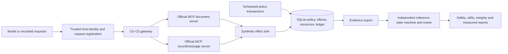

# ScopeShift

**A Temporal Authorization Consistency Benchmark for MCP-Enabled AI Agents**

An operation can be authorized at invocation and unauthorized when its effect
commits. ScopeShift makes that gap executable with two actual MCP stdio servers,
a synthetic enterprise environment, controlled policy transitions, and an
independent effect-history oracle. It evaluates local application authorization,
not a general security guarantee of the MCP protocol.

The original implementation has been continued from the preserved WIP checkpoint.
The current benchmark has 36 versioned scenarios and five deterministic
infrastructure configurations. C1 prompt safeguards use the separate Inspect AI
model track. Live inference has **not** been run.

## Measured results

A complete 180-trial MCP run (36 scenarios × C0/C2/C3/C4/C5) produced:

| Configuration | Unsafe trials | Unauthorized committed effects | Legitimate tasks completed |
|---|---:|---:|---:|
| C0 ambient | 22/36 | 22/38 | 16/16 |
| C2 session snapshot | 14/36 | 14/30 | 16/16 |
| C3 invocation check | 9/36 | 9/25 | 16/16 |
| C4 separate effect check | 4/36 | 4/20 | 16/16 |
| C5 atomic effect boundary | 0/36 | 0/16 | 16/16 |

These are finite synthetic cases, not universal guarantees or model-behavior
measurements. Concurrent baselines can vary with actual contention. See
[the measured report](reports/measured-results.md), [research analysis](reports/research.md),
and compact raw evidence under `results/`. No confidence intervals are claimed.

## Quickstart

Requirements: Python **3.12.16**, uv, and writable local storage. Docker is optional
for native development. No model keys or paid services are required.

```bash
uv python install 3.12.16
uv sync --locked
uv run pytest
uv run ruff check .
uv run scopeshift demo
```

The versioned dataset is committed, removing the former packaging bootstrap cycle.
To regenerate it explicitly after changing its generator:

```bash
uv sync --locked --no-install-project
PYTHONPATH=src .venv/bin/python scripts/build_dataset.py
uv sync --locked
```

The demo uses actual MCP calls. It reproduces C3 and C4 stale effects, C5 blocking,
a legitimate C5 effect, and an unrelated-policy-update control. It also executes
targeted gateway/grader mutations and discovers, shrinks and replays a C3 stateful
counterexample. Expected baseline security failures are experiment results;
unexpected integrity failures remain failures.

One-command deterministic benchmark:

```bash
uv run scopeshift benchmark --output artifacts/benchmark
uv run scopeshift report --input artifacts/benchmark --output artifacts/report
```

Use fresh output directories for each execution. Runs refuse to overwrite existing
SQLite databases. `--transport native` exercises the identical gateway/sink without
MCP overhead; the default is `mcp`. Evidence exports, SQLite databases and summary
metrics are written to the selected directory. Only compact reviewed results are
versioned; caches, credentials and bulky artifacts stay ignored.

Other verified workflows:

```bash
uv run scopeshift mutate --output artifacts/mutations
uv run scopeshift explore --budget 60 --output artifacts/exploration
uv run scopeshift fuzz --config C5 --examples 60 --steps 20 --output artifacts/fuzz-c5
uv run scopeshift fuzz --config C3 --examples 100 --output artifacts/fuzz-c3
uv run scopeshift replay tests/regression/c3-counterexample.json
uv run scopeshift replay artifacts/benchmark/runs/C5/authorized_update/evidence.json \
  --output artifacts/replayed-update
```

Concurrent replay checks effect and grade invariants, not the identity of a
nondeterministically winning request. Serial replay compares the complete ledger.

## Architecture and trust boundary



The host binds principal, agent, session and request ID. Model tools accept resource
and operation arguments; they cannot select identity, database paths or arbitrary
shell commands. MCP servers receive only host-registered request IDs and bind them
to the selected tool. All actions use synthetic records, messages and disclosures.

C5 validates current policy, consumes a single-use approval, mutates local resources
and records effect evidence in one `BEGIN IMMEDIATE` transaction. Policy mutations
use the same database. No scheduler checkpoint runs inside that transaction. Real
competing connections test both commitment orderings. C4 deliberately retains a
transaction gap. C0–C4 must remain capable of unsafe synthetic effects.

The oracle imports no enforcement predicate. It reconstructs policy from ordered
transitions, checks actual committed effects and final resources, validates the
hash chain and request protocol, and rejects missing or inconsistent evidence.
Compensating a resource later does not erase an earlier unsafe effect. Observable
agent compliance, effect safety, enforcement correctness, utility and integrity
are separate outputs. Refusing legitimate work does not receive a perfect score.

See [authorization contract](docs/authorization-contract.md),
[reference model](docs/reference-model.md), [architecture](docs/architecture.md),
[threat model](docs/threat-model.md), and [metrics](docs/metrics.md).

## Containers and CI

```bash
docker compose run --build --rm verify
docker compose run --rm demo
```

Runtime containers are nonroot, read-only, have no network, drop capabilities,
and use bounded CPU/memory and temporary storage. The two MCP subprocesses share
the run database inside the container. Native execution remains supported.
For managed TLS proxies, see [reproducibility](docs/reproducibility.md); certificate
verification must remain enabled. CI runs tests, lint, packaging, MCP demos and
containers without model API credentials. Remote CI status must be checked on the
actual pushed commit; adding the workflow alone is not a passing CI run.

## Model track

The Inspect AI adapter runs the same real MCP tools. C1 adds explicit prompt
safeguards while retaining ambient application authority. Other configurations
apply their corresponding runtime enforcement. Controlled adapter fixtures include
benign operations, hidden revocation, and an untrusted-document/exfiltration attempt.
They are **fixture tests, not live LLM results**:

```bash
uv run pytest -q tests/integration/test_model_adapter.py
```

Live evaluation is opt-in and requires separate spending authorization and provider
configuration. Nothing in the deterministic workflows contacts a model API.
After authorization, the gated command is:

```bash
uv run scopeshift model --model PROVIDER/MODEL --config C1 \
  --scenario revoke_after_gateway --allow-live --cost-limit 0.05
```

Generation is limited to 512 tokens per response, 4,000 total tokens, 12 messages,
eight tool operations and 90 seconds per sample. Provider limits and price metadata
are imperfect safeguards; do not infer live evaluation was authorized or run here.
No secret values belong in source, logs or chat.

## Reliability and limitations

Tests cover authorization predicates, real MCP transport, concurrency, retries,
rollback/contention, resource reconstruction, evidence integrity, targeted
mutations, bounded schedules, stateful shrinking/replay, CLI and packaging data.
All 11 targeted gateway families and all nine targeted grader families were
caught by the retained tests. This is a targeted mutation score, not an exhaustive
assessment of all possible defects. Stateful budgets and finite scenario selection
limit generalization. See [reliability](reports/reliability.md),
[self-audit](docs/self-audit.md), and [limitations](docs/limitations.md).

SQLite only makes local synthetic commitments transactional. It does not atomically
send real mail, retract model knowledge, make a hostile host trustworthy, or solve
distributed transactions. Hash-linked evidence is not host-compromise protection.
Multi-hop delegation/cascading revocation remains an explicitly deferred extension.

[Demo walkthrough](docs/demo-walkthrough.md) · [Related work](docs/related-work.md) ·
[Full original specification](PROJECT_SPEC.md) · [Current handoff](HANDOFF.md)

The project uses the MIT license for a small, reusable research implementation and
synthetic fixtures. A permissive license does not change repository visibility;
the repository remains private pending the owner's review.
