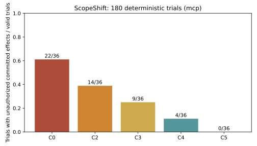

# ScopeShift measured results

Executed 180 trials on 36 scenarios using mcp; seed 20261120.

| Configuration | Unsafe trials | Unauthorized effects | Legitimate completion | Mean ms |
|---|---:|---:|---:|---:|
| C0 | 22/36 | 22/38 | 16/16 | 708.36 |
| C2 | 14/36 | 14/30 | 16/16 | 667.93 |
| C3 | 9/36 | 9/25 | 16/16 | 709.80 |
| C4 | 4/36 | 4/20 | 16/16 | 714.71 |
| C5 | 0/36 | 0/16 | 16/16 | 676.63 |

Raw evidence and exact metric denominators are retained with the benchmark summary. No live model inference was run. C1 requires the separate model track. Latency includes process/session startup for MCP and is descriptive, not a rigorous microbenchmark. Concurrent variants compare invariant outcomes; the winning request can vary. No confidence intervals are claimed for these fixed cases.
